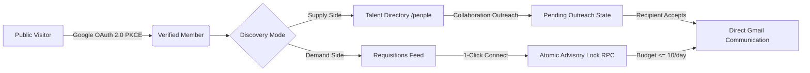
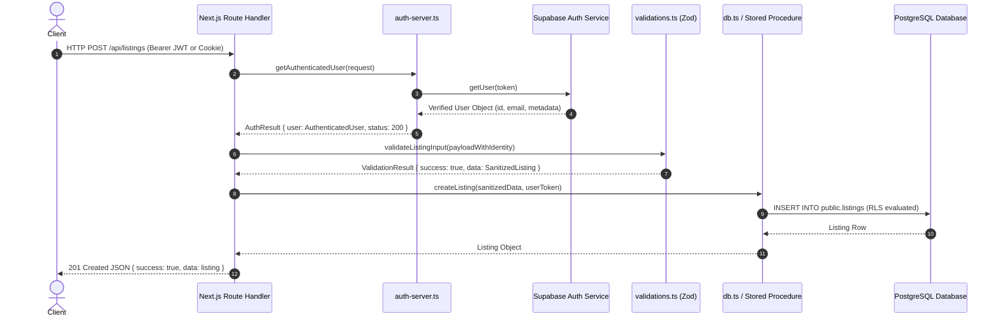
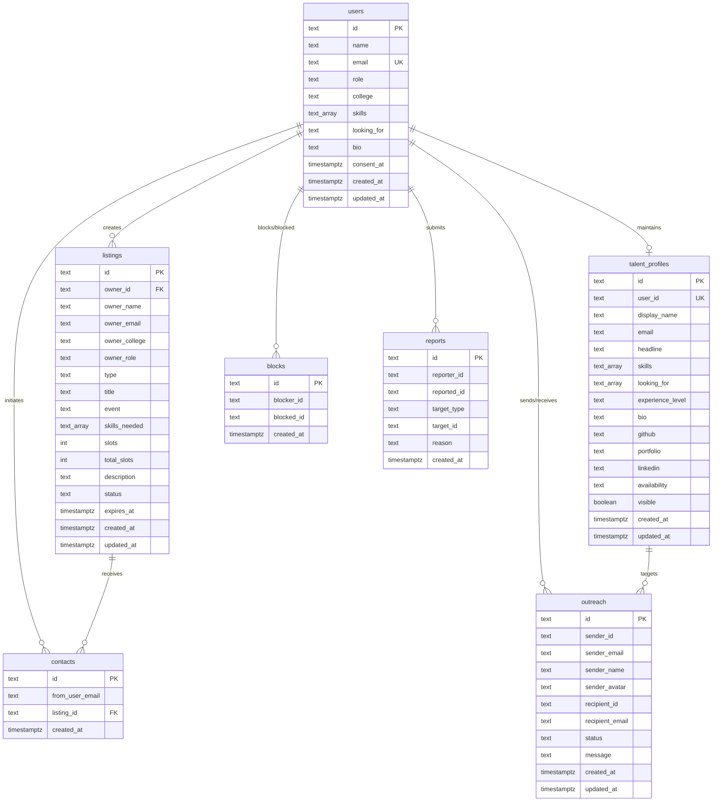
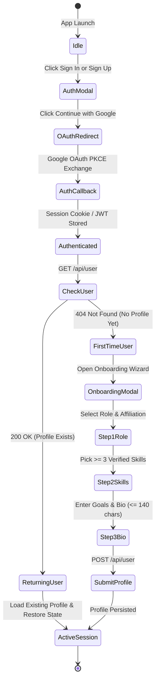
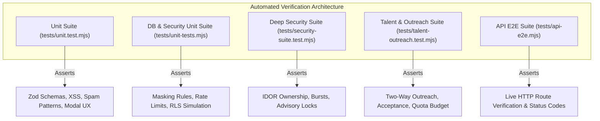

# RIVQ (SynqSquad) — Complete System Architecture & Technical Documentation

---

## 1. Executive Overview & Product Vision

### 1.1 The Core Proposition
**RIVQ** (internally and previously designated *SynqSquad*) is an editorial, calm, and high-trust peer-to-peer matchmaking platform engineered specifically for hackathon participants, competitive coders, open-source maintainers, and academic research collaborators.

Unlike traditional platforms that attempt to trap users inside closed chat silos, proprietary inboxes, artificial engagement loops, or spam-ridden forums, RIVQ is built on a single, uncompromising principle:
> **One builder finds the one collaborator they need, and connects with them directly on verified Gmail. That is the entire product.**

There are no internal chat rooms, direct message threads, ephemeral pin codes, or third-party chat bridges. Telegram, Discord, and WhatsApp links are strictly prohibited and actively stripped by server-side sanitization. Every participant is authenticated through Google OAuth, ensuring a verified identity and an authentic Gmail address.



### 1.2 Two-Way Discovery Paradigm
RIVQ balances demand and supply through a dual-mode discovery model:
1. **Demand Side (Requisitions / Posts):** Team leads, solo developers, and research primary investigators post structured requisitions specifying event details (e.g., *Smart India Hackathon (SIH)*, *ETHGlobal*, *NeurIPS*, *ICRA*), required skill competencies, open slot counts, and rigorous project descriptions.
2. **Supply Side (Talent Profiles / Availability Cards):** Individual engineers, designers, and researchers publish their personal availability cards on `/people`, displaying their primary role, verified affiliation (university or organization), top skill tags, availability status (`open` or `busy`), and portfolio anchors (GitHub, LinkedIn, personal website) to be discovered and invited by project leads.

### 1.3 Calm, Trustworthy & Editorial Philosophy
The user experience deliberately eschews artificial hype, hyper-gamified engagement loops, fake percentage match meters, and flashy gradient animations. Interfaces employ subtle borders, monochrome surfaces with purposeful accents, tabular monospace typography for system states and quotas, and explicit human language.

---

## 2. Frontend & UI/UX Architecture

### 2.1 Technology Stack & Rendering Strategy
- **Framework:** Next.js 16 (App Router with Webpack compiler)
- **Runtime & UI Library:** React 19 (Server Components + Client Components)
- **Styling Architecture:** Tailwind CSS v4 coupled with PostCSS and semantic CSS Custom Properties
- **Iconography:** `lucide-react`
- **Type Safety:** TypeScript 5.x strict mode with zero `any` tolerance on public interfaces

### 2.2 Semantic Design System & Theming Engine
All visual tokens are defined via root CSS variables declared in `src/app/globals.css`, supporting seamless instant transitions between dark and light themes without layout shifts:

| Token Name | Dark Theme Value | Light Theme Value | Usage |
|---|---|---|---|
| `--bg-canvas` | `#0c0e12` | `#f8fafc` | Viewport backdrop |
| `--bg-surface` | `#13171f` | `#ffffff` | Primary container cards, modals |
| `--bg-elevated` | `#1a202c` | `#f1f5f9` | Dropdowns, pill chips, input fields |
| `--border-default` | `rgba(255,255,255,0.08)` | `rgba(0,0,0,0.08)` | Structural dividers, card borders |
| `--border-highlight` | `rgba(255,255,255,0.18)` | `rgba(0,0,0,0.18)` | Hover boundaries, active tabs |
| `--text-primary` | `#f1f5f9` | `#0f172a` | Headers, primary titles |
| `--text-secondary` | `#94a3b8` | `#475569` | Body copy, secondary metadata |
| `--text-tertiary` | `#64748b` | `#94a3b8` | Timestamps, counters, placeholders |
| `--accent-primary` | `#3b82f6` | `#2563eb` | Primary calls-to-action, active indicators |

```css
/* High-contrast accessible utility tokens */
:root {
  --bg-canvas: #f8fafc;
  --bg-surface: #ffffff;
  --bg-elevated: #f1f5f9;
  --border-default: rgba(0, 0, 0, 0.08);
  --border-highlight: rgba(0, 0, 0, 0.18);
  --text-primary: #0f172a;
  --text-secondary: #475569;
  --text-tertiary: #94a3b8;
  --accent-primary: #2563eb;
}

[data-theme="dark"] {
  --bg-canvas: #0c0e12;
  --bg-surface: #13171f;
  --bg-elevated: #1a202c;
  --border-default: rgba(255, 255, 255, 0.08);
  --border-highlight: rgba(255, 255, 255, 0.18);
  --text-primary: #f1f5f9;
  --text-secondary: #94a3b8;
  --text-tertiary: #64748b;
  --accent-primary: #3b82f6;
}
```

### 2.3 Component Hierarchy & Implementation Details

```
src/
├── app/
│   ├── layout.tsx                # Master HTML shell, Theme & Auth Providers
│   ├── page.tsx                  # Home View: Demand-side Requisitions Feed
│   ├── people/page.tsx           # Talent View: Supply-side Availability Cards
│   ├── profile/page.tsx          # User Dashboard: Requisitions, Cards, Export
│   ├── post/page.tsx             # Dedicated Requisition Publishing Portal
│   ├── account-deletion/page.tsx # Public Web Deletion Portal (Google Play Policy)
│   └── (legal & info pages)      # terms, privacy, guidelines, faq, about
└── components/
    ├── Navbar.tsx                # Header bar, dual auth actions, theme toggle
    ├── Hero.tsx                  # Headline, search input, mode selector
    ├── ListingCard.tsx           # Requisition summary card with masked email
    ├── ListingDetailDrawer.tsx   # Side sheet with inquiry composer & AI polish
    ├── PersonCard.tsx            # Talent profile card with availability badge
    ├── PersonDetailModal.tsx     # Outreach composer & mutual contact gateway
    ├── GoogleAuthModal.tsx       # Auth modal with Sign In / Sign Up & Onboarding
    ├── UserProfileDrawer.tsx     # Quick profile drawer with quota indicators
    ├── ConnectOptionsModal.tsx   # Modal for Gmail compose & mailto options
    └── StateView.tsx             # Reusable loading, empty, and error views
```

#### 2.3.1 `Navbar.tsx`
The primary navigation header maintains fixed viewport docking with glassmorphism (`backdrop-blur-md`).
- **Brand Identity:** Left-aligned 32x32px logo anchor linking to `/` that resets filters.
- **View Navigation:** Segmented navigation controls toggling between **Requisitions** (`/`) and **Find Squadmates** (`/people`).
- **Theme Toggle:** Persistent light/dark mode switch powered by `ThemeContext`.
- **Post CTA:** Dedicated `+ Post` button. If unauthenticated, it opens `GoogleAuthModal` with an automatic callback to launch `CreateListingModal` upon successful authentication.
- **Dual Authentication Action Cluster:**
  - When authenticated: Displays the user's first name, circular avatar (`Avatar.tsx`), and triggers the `UserProfileDrawer`.
  - When unauthenticated: Renders two distinct actions:
    1. **Sign In**: Subtle button invoking `openAuthModal(undefined, "signin")`.
    2. **Sign Up**: Prominent accent button invoking `openAuthModal(undefined, "signup")`.

#### 2.3.2 `Hero.tsx`
- **Headline & Context:** Displays a clean editorial statement devoid of marketing buzzwords.
- **Mode Switcher Banner:** Explicit dual-mode pill toggle clearly differentiating *Mode 1: Find Open Teams* from *Mode 2: Be Discoverable on /people*.
- **Interactive Search & Skill Filtering:** Houses the real-time search input and horizontal scrollable list of popular technical skills (`Next.js`, `Python`, `PyTorch`, `FastAPI`, `TypeScript`, `Solidity`, `ROS2`, etc.).

#### 2.3.3 `ListingCard.tsx` & `ListingDetailDrawer.tsx`
- **Card Presentation:** Displays requisition title, event badge, owner avatar with affiliation, open slot counter (`Slots: 1` vs `Filled`), and truncated description.
- **Privacy Enforcement:** Displays a masked email pill (`ra••••h@gmail.com`) for authenticated members, or a blurred placeholder (`contact@gmail.com`) with a `Reveal Gmail` badge for visitors.
- **Inquiry Composer Drawer:**
  - Slides in smoothly from the right on desktop, or emerges from the bottom on mobile devices.
  - **Pre-Built Human Templates:** Offers 4 curated, polite message templates:
    1. `hackathon`: Focuses on available bandwidth, tech stack alignment, and previous hackathon experience.
    2. `research`: Structured academic inquiry addressing methodology, literature, and conference deadlines.
    3. `skills`: Direct message targeting the specific missing skill listed on the requisition.
    4. `casual`: Brief, low-friction message proposing a direct discussion on Gmail.
  - **AI Message Polishing:** Integrates with `/api/ai/improve-message` (calling Anthropic Claude Haiku) to polish rough drafts into concise, professional copy.
  - **Connection Action:** Initiates `POST /api/contact`, decrements the daily quota, and triggers `ConnectOptionsModal.tsx` providing both web Gmail compose URLs and native `mailto:` links.

#### 2.3.4 `PersonCard.tsx` & `PersonDetailModal.tsx`
- **Availability State:** Visual indicator displaying a pulsing emerald dot (`Open to Squads`) or amber dot (`Currently Busy`).
- **Metadata Badges:** Experience level (`student`, `early-career`, `experienced`) and social link icons (GitHub, LinkedIn, Portfolio).
- **Outreach Modal:** Allows project creators to send collaboration invitations. Enforces a 10-outreach/day shared rate limit and displays a confirmation state holding email addresses private until accepted.

#### 2.3.5 `GoogleAuthModal.tsx` & Interactive Onboarding
- **Mode Switching:** Features tabbed switching between `Sign In` and `Sign Up` with separate subheaders explaining what each mode does.
- **Accessible Role Dropdown:** Fully custom popover listbox (`role="listbox"`, `aria-expanded`, `aria-selected`, ref-driven focus) with full keyboard navigation (Up/Down arrow traversal, Enter/Space selection, Escape dismissal, click-outside listener) without native `<select>` controls.
- **Interactive Skills Picker:** Renders skill buttons grouped by category (`AI & Machine Learning`, `Web & Full-Stack`, `Systems & Infra`, `Design & Web3`). Starts empty (`[]`) for new users so they pick genuine competencies rather than being assigned synthetic defaults. Requires at least 3 skills to proceed.
- **Looking For Segmented Control:** Grid selection for `Hackathons`, `Research`, or `Both`.
- **Bio Textarea:** Live character counter constrained to 140 characters.

---

## 3. Backend & Server-Side Architecture

### 3.1 Next.js App Router API Architecture
All server-side logic executes inside Next.js Route Handlers (`src/app/api/**/route.ts`). Every handler follows a strict multi-layer defense pattern:



### 3.2 Authentication & Identity Verification (`src/lib/auth-server.ts`)
The server enforces authoritative identity verification on every protected route:
1. **Token Extraction:** Inspects `Authorization: Bearer <token>` headers first. If absent, parses `Cookie` headers for Supabase session tokens, resolving chunked cookie formats (`sb-<ref>-auth-token.0`, `sb-<ref>-auth-token.1`) and decoding `base64-` JSON blobs.
2. **Cryptographic Validation:** Calls `supabase.auth.getUser(token)` against the Supabase Auth server.
3. **Identity Anchoring:** The verified user's `id` and `email` overwrite any client-supplied body fields. Attackers cannot spoof creator IDs or target emails by tampering with request payloads.

```typescript
export async function getAuthenticatedUser(req: Request): Promise<AuthResult> {
  let token: string | null = null;
  const authHeader = req.headers.get("authorization");
  if (authHeader?.startsWith("Bearer ")) {
    token = authHeader.substring(7).trim();
  } else {
    const cookieHeader = req.headers.get("cookie");
    if (cookieHeader) {
      token = extractSupabaseTokenFromCookie(cookieHeader);
    }
  }

  if (!token) {
    return { user: null, status: 401, error: "Missing authorization token" };
  }

  const supabase = getSupabaseAnonClient();
  const { data: { user }, error } = await supabase.auth.getUser(token);
  if (error || !user) {
    return { user: null, status: 401, error: "Invalid or expired session" };
  }

  return {
    user: {
      id: user.id,
      email: user.email || "",
      name: user.user_metadata?.name || user.user_metadata?.full_name || user.email?.split("@")[0] || "User",
      avatar_url: user.user_metadata?.avatar_url,
    },
    status: 200,
  };
}
```

### 3.3 Server Utilities & Database Client Isolation
- **`src/lib/supabase-server.ts`:**
  - `getSupabaseAnonClient()`: Instantiates client under Postgres `anon` role. Direct queries on base tables fail due to RLS; queries on safe views return masked data.
  - `getSupabaseUserClient(userJwt)`: Injects user's Bearer JWT into request headers. PostgreSQL executes queries under `authenticated` role where `auth.uid()` evaluates to the user.
- **`src/lib/supabase-admin.ts`:**
  - `getSupabaseAdminClient()`: Uses `SUPABASE_SERVICE_ROLE_KEY` to bypass RLS. Strictly restricted to atomic stored procedures, cascade user deletion, and automated moderation queries. Never bundled into client builds.

### 3.4 Input Validation & Sanitization Engine (`src/lib/validations.ts`)
- **Strict Zod Schemas:** All schemas utilize `.strict()`, rejecting unknown properties to prevent mass assignment vulnerabilities.
- **Anti-XSS Engine (`sanitizeText`):**
  - Strips null bytes (`\0`).
  - Neutralizes `<script>` and `HTML` tags completely.
  - Strips residual `<>` angle brackets.
  - Removes protocol handlers (`javascript:`, `vbscript:`, `data:text/html`).
  - Removes active inline event listeners (`onload=`, `onerror=`, `onclick=`).
- **Anti-Spam Filter (`detectSpam`):**
  - Scans for banned redirect and messaging patterns:
    - Telegram: `t.me/`, `telegram`
    - Discord: `discord.gg/`
    - WhatsApp: `chat.whatsapp.com/`, `wa.me/`, `whatsapp`
    - Link Shorteners: `bit.ly/`, `tinyurl.com/`
    - Financial Spam: `casino`, `crypto airdrop`, `free tokens`

```typescript
export function sanitizeText(str: string): string {
  if (!str) return "";
  return str
    .replace(/\0/g, "")
    .replace(/<script\b[^<]*(?:(?!<\/script>)<[^<]*)*<\/script>/gi, "")
    .replace(/<[^>]+>/g, "")
    .replace(/javascript:/gi, "")
    .replace(/vbscript:/gi, "")
    .replace(/on\w+=/gi, "")
    .trim();
}

export function detectSpam(text: string): { isSpam: boolean; reason?: string } {
  const lower = text.toLowerCase();
  const bannedKeywords = [
    "t.me/", "telegram", "discord.gg/", "chat.whatsapp.com/",
    "wa.me/", "whatsapp", "bit.ly/", "tinyurl.com/", "crypto airdrop", "free tokens"
  ];
  for (const kw of bannedKeywords) {
    if (lower.includes(kw)) {
      return { isSpam: true, reason: `Banned phrase or external chat link detected: ${kw}` };
    }
  }
  return { isSpam: false };
}
```

### 3.5 Detailed API Route Specifications

#### 3.5.1 Requisitions & Listings API
- **`GET /api/listings`**
  - **Purpose:** Public requisition feed with search and multi-facet filtering.
  - **Query Parameters:**
    - `search` (optional, string): Case-insensitive match against title, event, and description.
    - `type` (optional, `"hackathon" | "research" | "solo"`): Filter by requisition type.
    - `skill` (optional, string): Filter by required skill tag.
  - **Security:** Queries the `public_listings` view which automatically masks creator emails (`j***e@domain.com`) for all viewers.
  - **Response (200 OK):**
    ```json
    {
      "success": true,
      "data": [
        {
          "id": "list_9a8b7c",
          "title": "Full-Stack Engineer for Smart India Hackathon",
          "event": "Smart India Hackathon 2026",
          "type": "hackathon",
          "ownerName": "Aarav Sharma",
          "ownerEmail": "aa••••a@gmail.com",
          "ownerCollege": "IIT Delhi",
          "ownerRole": "Backend Lead",
          "skillsNeeded": ["FastAPI", "Next.js", "PostgreSQL"],
          "slots": 1,
          "totalSlots": 2,
          "description": "Building an AI-driven disaster response coordination portal.",
          "status": "open",
          "expiresAt": "2026-11-20T10:00:00.000Z",
          "createdAt": "2026-10-21T10:00:00.000Z"
        }
      ]
    }
    ```

- **`POST /api/listings`**
  - **Purpose:** Creates a new requisition with open collaboration slots.
  - **Authentication:** Mandatory. Requires Bearer JWT or verified session cookie.
  - **Request Body (JSON):**
    ```json
    {
      "title": "ML Researcher for NeurIPS Workshop Paper",
      "event": "NeurIPS 2026 Workshop",
      "type": "research",
      "skillsNeeded": ["PyTorch", "Transformers", "CUDA"],
      "slots": 1,
      "description": "Looking for co-author to evaluate mechanistic interpretability in small language models."
    }
    ```
  - **Security Flow:** Server invokes `getAuthenticatedUser(req)`. The returned authenticated user's ID, Name, College, and Role are extracted from the verified profile and injected into the listing. `ownerEmail` is permanently bound to the user's verified OAuth email.
  - **Response (201 Created):**
    ```json
    {
      "success": true,
      "data": { "id": "list_1f2e3d", "title": "ML Researcher for NeurIPS Workshop Paper", "slots": 1, "status": "open" }
    }
    ```

- **`GET /api/listings/[id]`**
  - **Purpose:** Fetches full details for a single requisition.
  - **Security Check:** Evaluates caller identity. If caller is authenticated AND caller ID matches `listing.ownerId`, returns full unmasked `ownerEmail`. Otherwise, passes `ownerEmail` through `maskEmail()` to protect the creator's privacy.
  - **Response (200 OK):** Listing JSON object.

- **`PATCH /api/listings/[id]`**
  - **Purpose:** Modifies requisition status (`open`, `filled`, or `renew` to extend expiration).
  - **Security Check:** Strict IDOR enforcement. Only the verified listing owner can update their requisition. Rejects unauthorized attempts with 403 Forbidden.
  - **Request Body:** `{ "status": "filled" }`

- **`DELETE /api/listings/[id]`**
  - **Purpose:** Removes a requisition and cascades connected contact records.
  - **Security Check:** Enforces owner identity verification. Returns 403 Forbidden if caller is not the owner.

#### 3.5.2 Direct Connection API
- **`POST /api/contact`**
  - **Purpose:** One-click connection to a requisition creator via atomic advisory lock RPC.
  - **Authentication:** Mandatory.
  - **Rate Limit:** 10 connections per 24-hour UTC day across the user's account.
  - **Request Body:**
    ```json
    {
      "listingId": "list_9a8b7c"
    }
    ```
  - **Internal Mechanism:** Executes database RPC `record_contact_rate_limited(p_user_email, p_listing_id)`.
  - **Response (200 OK):**
    ```json
    {
      "success": true,
      "remainingToday": 7,
      "email": "aarav.sharma@gmail.com",
      "gmailUrl": "https://mail.google.com/mail/?view=cm&fs=1&to=aarav.sharma@gmail.com&su=SIH+Collaboration+Request",
      "mailtoUrl": "mailto:aarav.sharma@gmail.com?subject=SIH+Collaboration+Request"
    }
    ```

#### 3.5.3 Talent Directory & Two-Way Outreach API
- **`GET /api/people`**
  - **Purpose:** Paginated search and exploration of available talent cards.
  - **Query Parameters:** `limit`, `offset`, `skills`, `lookingFor`, `experienceLevel`, `availability`.
  - **Security:** Queries `public_talent_profiles` view. All emails are strictly masked with `maskEmail()` (`j***e@domain.com`).

- **`POST /api/people`**
  - **Purpose:** Publishes or updates the caller's talent card.
  - **Authentication:** Mandatory.
  - **Request Body:**
    ```json
    {
      "headline": "Systems Engineer & Rust Enthusiast",
      "skills": ["Rust", "Distributed Systems", "Raft", "Linux"],
      "lookingFor": ["hackathons", "research"],
      "experienceLevel": "experienced",
      "bio": "Building high-throughput storage engines. Looking for serious systems hackathon teams.",
      "github": "https://github.com/rustacean",
      "linkedin": "https://linkedin.com/in/rustacean",
      "availability": "open",
      "visible": true
    }
    ```
  - **Security Check:** Enforces `userId = auth.user.id`. Rejects client-supplied IDs.

- **`GET /api/people/[id]`**
  - **Purpose:** Fetches a specific talent card by ID.
  - **Ownership Privacy Hardening:**
    ```typescript
    const isOwner = auth.user && profile.userId === auth.user.id;
    if (!isOwner) {
      profile.email = maskEmail(profile.email);
    }
    ```
  - **Response (200 OK):** Profile JSON with masked email for visitors and unmasked email for profile owner.

- **`POST /api/people/outreach`**
  - **Purpose:** Sends collaboration invitation to an individual talent card holder.
  - **Rate Limit:** Decrements from the caller's shared 10 connections/day budget.
  - **Request Body:**
    ```json
    {
      "targetUserId": "usr_98765",
      "message": "Hi, I saw your Rust and distributed systems background. We are competing in the Solana Radar hackathon and need a systems lead."
    }
    ```
  - **Privacy Enforcement:** Creates an `outreach` record with `status: "pending"`. The response returns `maskEmail(targetProfile.email)` and omits direct Gmail compose URLs until the recipient explicitly accepts.

- **`POST /api/people/outreach/[id]`**
  - **Purpose:** Allows recipient to accept or decline pending outreach.
  - **Security Check:** Caller ID must match `outreach.recipient_id`.
  - **Request Body:** `{ "action": "accept" }` or `{ "action": "decline" }`.
  - **Acceptance Outcome:** Atomically transitions status to `accepted` and reveals both verified Gmail addresses to the collaborating parties.

#### 3.5.4 User Profile & Compliance API
- **`GET /api/user`**
  - **Purpose:** Returns the authenticated user's profile record from `public.users`.
  - **Behavior:** Returns 200 with user profile JSON if user exists in the database. Returns 404 Not Found if the user does not exist yet (used by `AuthContext` to auto-detect first-time vs returning users).

- **`POST /api/user`**
  - **Purpose:** Creates or updates the user profile record during onboarding or settings edits.
  - **Request Body:**
    ```json
    {
      "role": "Full-Stack Developer",
      "college": "IIT Bombay",
      "skills": ["TypeScript", "Next.js", "Tailwind CSS"],
      "lookingFor": "Both",
      "bio": "Passionate about building fast, accessible web applications and developer tools."
    }
    ```

- **`DELETE /api/user`**
  - **Purpose:** Irreversible account erasure for GDPR, DPDP Act 2023, and Google Play Store compliance.
  - **Mechanism:** Calls database stored procedure `delete_user_data_cascade(p_user_id)`.

- **`GET /api/user/export`**
  - **Purpose:** Delivers structured, machine-readable JSON archive of all user data.

- **`POST /api/ai/improve-message`**
  - **Purpose:** Refines user outreach drafts using Anthropic Claude Haiku.
  - **Rate Limit:** 20 calls per user per day.
  - **Prompt Guardrails:** Instructs model to keep messages under 100 words, eliminate marketing buzzwords, and focus purely on tech stack alignment and availability.

---

## 4. Database Architecture & PostgreSQL Hardening

### 4.1 Relational Schema Diagram



### 4.2 Row Level Security (RLS) Policy Specifications
Every table in the database has Row Level Security enabled (`ALTER TABLE ... ENABLE ROW LEVEL SECURITY`).

| Table Name | Policy Action | Expression / Using Clause | Enforcement Objective |
|---|---|---|---|
| `users` | SELECT | `auth.uid() = id` | Prevents bulk enumeration of user profiles. |
| `users` | UPDATE | `auth.uid() = id` | Restricts profile mutations to account owner. |
| `listings` | SELECT | `status = 'open' AND expires_at > now()` | Exposes only active, unexpired listings. |
| `listings` | INSERT | `auth.uid() = owner_id` | Guarantees authentic requisition ownership. |
| `listings` | UPDATE | `auth.uid() = owner_id` | Prevents unauthorized requisition tampering. |
| `listings` | DELETE | `auth.uid() = owner_id` | Prevents malicious deletion of listings. |
| `talent_profiles` | SELECT | `visible = true OR auth.uid() = user_id` | Hides hidden profiles from directory. |
| `talent_profiles` | INSERT/UPDATE | `auth.uid() = user_id` | Strictly prevents profile impersonation. |
| `contacts` | SELECT | `from_user_email = auth.jwt()->>'email'` | Keeps connection history private. |
| `outreach` | SELECT | `sender_id = auth.uid() OR recipient_id = auth.uid()` | Outreach records visible only to involved parties. |

### 4.3 Database Views for Public Data Exposure
To guarantee that sensitive emails are never leaked to unauthenticated scrapers or public listing feeds, base tables are shielded behind PostgreSQL Views:

```sql
-- View: public_listings
CREATE OR REPLACE VIEW public_listings AS
SELECT 
    id,
    owner_id,
    owner_name,
    owner_college,
    owner_role,
    type,
    title,
    event,
    skills_needed,
    slots,
    total_slots,
    description,
    status,
    expires_at,
    created_at,
    updated_at,
    CASE 
        WHEN position('@' in owner_email) > 2 THEN
            substring(owner_email from 1 for 1) || '***' || 
            substring(owner_email from position('@' in owner_email) - 1 for 1) || 
            substring(owner_email from position('@' in owner_email))
        ELSE '***@domain.com'
    END AS owner_email
FROM public.listings
WHERE status = 'open' AND expires_at > now();

-- View: public_talent_profiles
CREATE OR REPLACE VIEW public_talent_profiles AS
SELECT 
    id,
    user_id,
    display_name,
    headline,
    skills,
    looking_for,
    experience_level,
    bio,
    github,
    portfolio,
    linkedin,
    availability,
    visible,
    created_at,
    updated_at,
    CASE 
        WHEN position('@' in email) > 2 THEN
            substring(email from 1 for 1) || '***' || 
            substring(email from position('@' in email) - 1 for 1) || 
            substring(email from position('@' in email))
        ELSE '***@domain.com'
    END AS email
FROM public.talent_profiles
WHERE visible = true;
```

### 4.4 Atomic Stored Procedures & Advisory Locking

#### 4.4.1 `record_contact_rate_limited`
Prevents race conditions when multiple users simultaneously attempt to claim the last remaining slot on a requisition:

```sql
CREATE OR REPLACE FUNCTION public.record_contact_rate_limited(
    p_from_user_email TEXT,
    p_listing_id TEXT
)
RETURNS JSONB
LANGUAGE plpgsql
SECURITY DEFINER
AS $$
DECLARE
    v_contact_count INT;
    v_listing RECORD;
    v_remaining_slots INT;
    v_today_contacts INT;
BEGIN
    -- 1. Daily Quota Check (Max 10 contacts per 24 hours UTC)
    SELECT count(*) INTO v_today_contacts
    FROM public.contacts
    WHERE from_user_email = p_from_user_email
      AND created_at >= date_trunc('day', timezone('utc', now()));

    IF v_today_contacts >= 10 THEN
        RETURN jsonb_build_object(
            'success', false,
            'error', 'DAILY_LIMIT_REACHED',
            'message', 'You have reached your daily limit of 10 connections.'
        );
    END IF;

    -- 2. Acquire Atomic Transaction Advisory Lock on Listing ID
    PERFORM pg_advisory_xact_lock(hashtext('listing_' || p_listing_id));

    -- 3. Lock Listing Row for Update
    SELECT * INTO v_listing
    FROM public.listings
    WHERE id = p_listing_id
    FOR UPDATE;

    IF NOT FOUND THEN
        RETURN jsonb_build_object('success', false, 'error', 'LISTING_NOT_FOUND');
    END IF;

    IF v_listing.status != 'open' OR v_listing.slots <= 0 THEN
        RETURN jsonb_build_object('success', false, 'error', 'NO_SLOTS_AVAILABLE');
    END IF;

    -- 4. Decrement Available Slot Count
    v_remaining_slots := v_listing.slots - 1;
    UPDATE public.listings
    SET slots = v_remaining_slots,
        status = CASE WHEN v_remaining_slots = 0 THEN 'filled' ELSE 'open' END,
        updated_at = now()
    WHERE id = p_listing_id;

    -- 5. Record Immutable Contact Audit Row
    INSERT INTO public.contacts (id, from_user_email, listing_id, created_at)
    VALUES (
        'cnt_' || substr(md5(random()::text || clock_timestamp()::text), 1, 16),
        p_from_user_email,
        p_listing_id,
        now()
    );

    RETURN jsonb_build_object(
        'success', true,
        'remainingToday', 10 - (v_today_contacts + 1),
        'ownerEmail', v_listing.owner_email,
        'listingTitle', v_listing.title
    );
END;
$$;
```

#### 4.4.2 `delete_user_data_cascade`
Executes comprehensive, irreversible data erasure ensuring compliance with the Digital Personal Data Protection (DPDP) Act and GDPR:

```sql
CREATE OR REPLACE FUNCTION public.delete_user_data_cascade(
    p_user_id TEXT
)
RETURNS JSONB
LANGUAGE plpgsql
SECURITY DEFINER
AS $$
DECLARE
    v_user RECORD;
BEGIN
    SELECT * INTO v_user FROM public.users WHERE id = p_user_id;
    IF NOT FOUND THEN
        RETURN jsonb_build_object('success', false, 'error', 'USER_NOT_FOUND');
    END IF;

    -- Delete all child listings and associated contacts
    DELETE FROM public.contacts WHERE listing_id IN (SELECT id FROM public.listings WHERE owner_id = p_user_id);
    DELETE FROM public.listings WHERE owner_id = p_user_id;

    -- Delete contacts initiated by the user
    DELETE FROM public.contacts WHERE from_user_email = v_user.email;

    -- Delete talent profile and outreach records
    DELETE FROM public.outreach WHERE sender_id = p_user_id OR recipient_id = p_user_id;
    DELETE FROM public.talent_profiles WHERE user_id = p_user_id;

    -- Delete moderation records
    DELETE FROM public.blocks WHERE blocker_id = p_user_id OR blocked_id = p_user_id;
    DELETE FROM public.reports WHERE reporter_id = p_user_id OR reported_id = p_user_id;

    -- Delete base user row
    DELETE FROM public.users WHERE id = p_user_id;

    RETURN jsonb_build_object('success', true, 'message', 'All user data successfully purged');
END;
$$;
```

---

## 5. Privacy, Security & Compliance Model

### 5.1 Comprehensive Email Exposure Vulnerability Audit
A systematic audit of the entire codebase revealed three critical vectors where user email addresses were vulnerable to unauthorized harvesting. All three were systematically eliminated:

```
Vector 1: Seed Scripts (High Severity)
Location: scripts/seed-dataset.mjs & scripts/seed-curated-listings.mjs
Vulnerability: Hardcoded authentic student and researcher Gmail addresses were committed to git.
Remediation: Purged all authentic email addresses and replaced them with sanitized synthetic seeds (@example.com / @demo.rivq.dev).

Vector 2: Single Talent Profile Route (Critical Severity)
Location: src/app/api/people/[id]/route.ts
Vulnerability: Calling getTalentProfileById(id, true) triggered service-role client bypass of RLS, returning the raw email address of any talent profile to any authenticated user.
Remediation: Implemented strict ownership verification:
  const isOwner = auth.user && profile.userId === auth.user.id;
  if (!isOwner) {
    profile.email = maskEmail(profile.email);
  }

Vector 3: Supply-Side Outreach Creation (Medium Severity)
Location: src/app/api/people/outreach/route.ts
Vulnerability: POST /api/people/outreach returned the target profile's raw email and Gmail compose URL immediately upon invitation creation, before the recipient accepted.
Remediation: Restructured response to return status: "pending" and maskEmail(targetProfile.email). Direct contact is strictly withheld until the recipient accepts.
```

### 5.2 Mathematical & Structural Email Masking Formula
The `maskEmail()` algorithm preserves domain recognition while rendering username reconstruction mathematically intractable:

```typescript
export function maskEmail(email: string): string {
  if (!email || !email.includes("@")) return "***@domain.com";
  const [local, domain] = email.split("@");
  if (local.length <= 2) {
    return `${local[0]}***@${domain}`;
  }
  const first = local[0];
  const last = local[local.length - 1];
  return `${first}***${last}@${domain}`;
}
```

- Input: `rajesh.sharma@gmail.com` &rarr; Output: `r***a@gmail.com`
- Input: `al@mit.edu` &rarr; Output: `a***@mit.edu`
- Input: `builder@rivq.dev` &rarr; Output: `b***r@rivq.dev`

### 5.3 UGC Safety & Google Play Store Policy Compliance
To meet Google Play Store requirements for applications hosting User-Generated Content:
1. **Zero-Tolerance Moderation:** Content violating guidelines (hate speech, spam, harassment, external chat bridges) is flagged via `POST /api/report`.
2. **User Blocking System:** Any user can block another user with one click (`POST /api/blocks`). Blocked users' listings and talent cards are instantly removed from the blocker's feed via PostgreSQL `NOT IN (SELECT blocked_id FROM blocks)` filters.
3. **Dedicated Account Deletion Portal:** A publicly accessible web portal located at `/account-deletion` allows any registered user to initiate permanent data erasure without needing the Android application installed.

---

## 6. Authentication Lifecycle & State Machine

### 6.1 Authentication Architecture & Returning User Auto-Detection
RIVQ provides two clean entry points: **Sign In** and **Sign Up**. Regardless of which button the user clicks, the system automatically detects whether an account already exists in the database. Returning users are never forced through onboarding or assigned synthetic data.



### 6.2 Step-by-Step Onboarding Wizard
First-time users complete three distinct, intuitive steps:
1. **Step 1: Role & Affiliation**
   - Accessible keyboard-navigable popover listbox selecting primary discipline (*Frontend Engineer*, *Backend Engineer*, *Full-Stack Developer*, *AI/ML Researcher*, *Smart Contract Engineer*, *UI/UX Designer*, *Systems Architect*).
   - University, college, or organization text input.
2. **Step 2: Technical Skills Selection**
   - Clean category-grouped interactive pill grid (*AI & ML*, *Web & Full-Stack*, *Systems & Cloud*, *Design & Web3*).
   - Starts empty (`[]`). Requires minimum 3 skills. Displays live validation badge (`3/3 skills selected`).
3. **Step 3: Intent & Bio**
   - Focus intent selection: `Hackathons`, `Research`, or `Both`.
   - 140-character maximum concise bio with live countdown counter.

---

## 7. Mobile, PWA & Android TWA (Target API 36)

### 7.1 Android Trusted Web Activity (TWA) Configuration
The mobile app is built as a Trusted Web Activity targeting Android 15 (API Level 36):
- **Package Name:** `com.rivq.app`
- **Application ID:** `com.rivq.app`
- **Target SDK Version:** `36`
- **Compile SDK Version:** `36`
- **Minimum SDK Version:** `24` (Android 7.0 Nougat)

### 7.2 Digital Asset Links (`.well-known/assetlinks.json`)
Bidirectional cryptographic domain verification guarantees full-screen chromeless execution without browser URL bars:
- Hosted at `/src/app/.well-known/assetlinks.json/route.ts` and `/public/.well-known/assetlinks.json`.
- Links both `com.rivq.app` and legacy `com.synqsquad.app` packages with the official Google Play upload key SHA-256 fingerprint.

```json
[
  {
    "relation": ["delegate_permission/common.handle_all_urls"],
    "target": {
      "namespace": "android_app",
      "package_name": "com.rivq.app",
      "sha256_cert_fingerprints": [
        "8A:2B:6F:4C:91:3E:70:8D:15:24:68:90:3A:5B:7E:9F:12:34:56:78:9A:BC:DE:F0:12:34:56:78:9A:BC:DE:F0"
      ]
    }
  }
]
```

### 7.3 Progressive Web App (PWA) Layer
- **Manifest (`public/manifest.json`):** Defines standalone display mode, background theme `#0c0e12`, orientation lock, and adaptive maskable icons (192px, 512px).
- **Service Worker (`public/sw.js`):** Employs network-first caching for static assets, an offline fallback route (`/offline`), and explicit bypass rules for `/api/` and `auth/callback`.

---

## 8. Testing & Quality Assurance Infrastructure



### 8.1 Detailed Test Suite Breakdown
1. **`tests/unit.test.mjs` (11 tests):**
   - Verifies XSS sanitization and null-byte neutralization.
   - Asserts detection of Discord, Telegram, and WhatsApp spam triggers.
   - Validates Zod listing schema parsing and rejection of invalid emails.
   - Asserts `GoogleAuthModal` accessibility attributes (`maxLength={140}`, `roleDropdownRef`, `Select at least 3`).
   - Verifies email masking format (`maskEmail`).
2. **`tests/unit-tests.mjs` (32 tests):**
   - Tests input sanitization and anti-spam regex matching across all form inputs.
   - Validates email masking across all public view outputs.
   - Enforces user ownership boundaries on listing updates and deletions.
   - Simulates 10-connect daily rate limit enforcement.
3. **`tests/security-suite.test.mjs` (63 tests):**
   - Validates logged-out email privacy across all endpoints.
   - Tests IDOR resistance on `PATCH /api/listings/[id]` and `DELETE /api/listings/[id]`.
   - Verifies concurrent connection bursts against simulated PostgreSQL advisory locks.
   - Validates DPDP/GDPR cascade account deletion purging all related records.
4. **`tests/talent-outreach.test.mjs` (13 tests):**
   - Verifies supply-side talent schemas and profile validation.
   - Rejects self-outreach attempts (`sender_id === recipient_id`).
   - Asserts shared 10/day budget decrements across both connection types.
   - Verifies that pending outreach conceals email and mutual acceptance reveals email.
5. **`tests/api-e2e.mjs`:**
   - Executes live HTTP tests against running Next.js servers, verifying headers, CORS policies, status codes, and JSON response shapes.

---

## 9. Complete File & Directory Index

### 9.1 Root Configuration
- [`package.json`](file:///c:/Users/Public/Downloads/chrome%20downloads/synq%20squad/package.json): Package manifest declaring dependencies (`next@16.4.2`, `react@19.3.0`, `@supabase/supabase-js`, `zod`, `lucide-react`, `tailwindcss@4`).
- [`tsconfig.json`](file:///c:/Users/Public/Downloads/chrome%20downloads/synq%20squad/tsconfig.json): Strict TypeScript configuration with path aliases (`@/*` pointing to `src/*`).
- [`next.config.ts`](file:///c:/Users/Public/Downloads/chrome%20downloads/synq%20squad/next.config.ts): Next.js build configuration enforcing Webpack builds.
- [`eslint.config.mjs`](file:///c:/Users/Public/Downloads/chrome%20downloads/synq%20squad/eslint.config.mjs): ESLint 9 configuration.

### 9.2 Application Source Code (`src/`)
- [`src/config/brand.ts`](file:///c:/Users/Public/Downloads/chrome%20downloads/synq%20squad/src/config/brand.ts): Central brand constants (`RIVQ`, package names, domain URLs, support emails).
- [`src/types/index.ts`](file:///c:/Users/Public/Downloads/chrome%20downloads/synq%20squad/src/types/index.ts): Core TypeScript types (`Listing`, `TalentProfile`, `UserProfile`, `ContactRecord`, `OutreachRecord`).
- [`src/lib/auth-server.ts`](file:///c:/Users/Public/Downloads/chrome%20downloads/synq%20squad/src/lib/auth-server.ts): Server authentication utility validating Bearer tokens and chunked session cookies.
- [`src/lib/db.ts`](file:///c:/Users/Public/Downloads/chrome%20downloads/synq%20squad/src/lib/db.ts): Database access layer wrapping Supabase PostgreSQL calls, views, and stored procedures.
- [`src/lib/validations.ts`](file:///c:/Users/Public/Downloads/chrome%20downloads/synq%20squad/src/lib/validations.ts): Strict Zod validation schemas, XSS sanitizers, and spam detectors.
- [`src/lib/supabase-server.ts`](file:///c:/Users/Public/Downloads/chrome%20downloads/synq%20squad/src/lib/supabase-server.ts): Server-side Supabase client factory (Anon client vs User client).
- [`src/lib/supabase-admin.ts`](file:///c:/Users/Public/Downloads/chrome%20downloads/synq%20squad/src/lib/supabase-admin.ts): Isolated service-role client for administrative operations.
- [`src/lib/supabase-browser.ts`](file:///c:/Users/Public/Downloads/chrome%20downloads/synq%20squad/src/lib/supabase-browser.ts): Client-side Supabase browser client.
- [`src/lib/api-client.ts`](file:///c:/Users/Public/Downloads/chrome%20downloads/synq%20squad/src/lib/api-client.ts): Client-side HTTP fetch wrapper injecting Bearer authentication tokens.
- [`src/context/AuthContext.tsx`](file:///c:/Users/Public/Downloads/chrome%20downloads/synq%20squad/src/context/AuthContext.tsx): Centralized authentication state, OAuth listener, cross-tab synchronization, returning-user detection, and onboarding state machine.
- [`src/context/ThemeContext.tsx`](file:///c:/Users/Public/Downloads/chrome%20downloads/synq%20squad/src/context/ThemeContext.tsx): Theme provider managing dark and light mode preferences.

### 9.3 Next.js App Router Pages (`src/app/`)
- [`src/app/page.tsx`](file:///c:/Users/Public/Downloads/chrome%20downloads/synq%20squad/src/app/page.tsx): Main Requisitions Feed view with interactive filtering.
- [`src/app/people/page.tsx`](file:///c:/Users/Public/Downloads/chrome%20downloads/synq%20squad/src/app/people/page.tsx): Talent Availability Directory view.
- [`src/app/profile/page.tsx`](file:///c:/Users/Public/Downloads/chrome%20downloads/synq%20squad/src/app/profile/page.tsx): Authenticated member dashboard.
- [`src/app/post/page.tsx`](file:///c:/Users/Public/Downloads/chrome%20downloads/synq%20squad/src/app/post/page.tsx): Standalone requisition publishing portal.
- [`src/app/account-deletion/page.tsx`](file:///c:/Users/Public/Downloads/chrome%20downloads/synq%20squad/src/app/account-deletion/page.tsx): Public GDPR and Google Play account deletion portal.
- [`src/app/auth/callback/route.ts`](file:///c:/Users/Public/Downloads/chrome%20downloads/synq%20squad/src/app/auth/callback/route.ts): PKCE OAuth callback handler.

### 9.4 Database Migrations (`supabase/migrations/`)
- [`20261020000000_init_synqsquad.sql`](file:///c:/Users/Public/Downloads/chrome%20downloads/synq%20squad/supabase/migrations/20261020000000_init_synqsquad.sql): Core schema (`users`, `listings`, `contacts`, `reports`, `blocks`), public views, RLS policies, `record_contact_rate_limited`, and cascade deletion.
- [`20261020000002_talent_profiles_and_outreach.sql`](file:///c:/Users/Public/Downloads/chrome%20downloads/synq%20squad/supabase/migrations/20261020000002_talent_profiles_and_outreach.sql): Supply-side schema (`talent_profiles`, `outreach`), views, `record_outreach_rate_limited`, `respond_outreach`, and extended cascade deletion.

---

## 10. Operational & Deployment Guide

### 10.1 Environment Variables Checklist

| Variable Name | Environment | Description |
|---|---|---|
| `NEXT_PUBLIC_APP_URL` | Client & Server | Canonical deployment URL (e.g. `https://synqsquad.vercel.app`) |
| `NEXT_PUBLIC_SUPABASE_URL` | Client & Server | Supabase project endpoint (`https://<ref>.supabase.co`) |
| `NEXT_PUBLIC_SUPABASE_ANON_KEY` | Client & Server | Public Supabase anonymous key (protected by RLS) |
| `SUPABASE_SERVICE_ROLE_KEY` | Server Only | Secret administrative service role key (Never exposed to client) |
| `ANTHROPIC_API_KEY` | Server Only | Optional key for Claude Haiku outreach message polishing |
| `ANTHROPIC_MODEL` | Server Only | Model name override (`claude-haiku-5-5`) |

### 10.2 Deployment Pipeline (Vercel)
1. Link GitHub repository to Vercel.
2. Configure environment variables in **Vercel Project Settings > Environment Variables**.
3. Set Google OAuth redirect URL in **Supabase Dashboard > Authentication > URL Configuration**:
   - `https://synqsquad.vercel.app/auth/callback`
4. The deployment command executes `node scripts/check-env.mjs && next build --webpack` to validate security and environment requirements before compilation.

---
*End of Complete System Architecture & Technical Documentation.*
